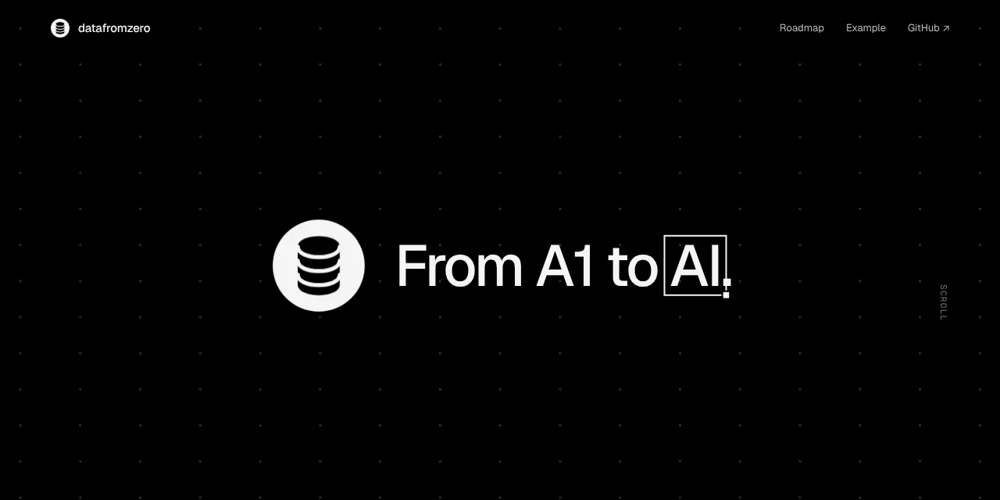
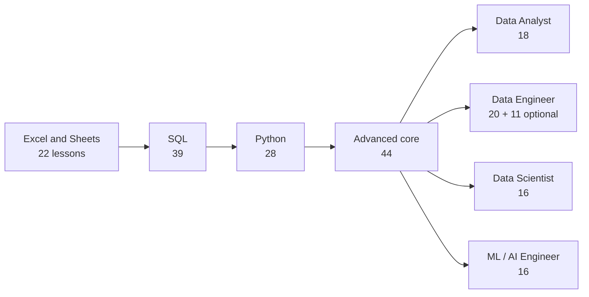
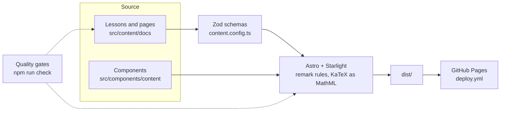
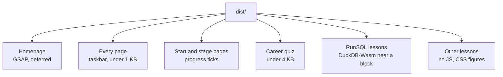
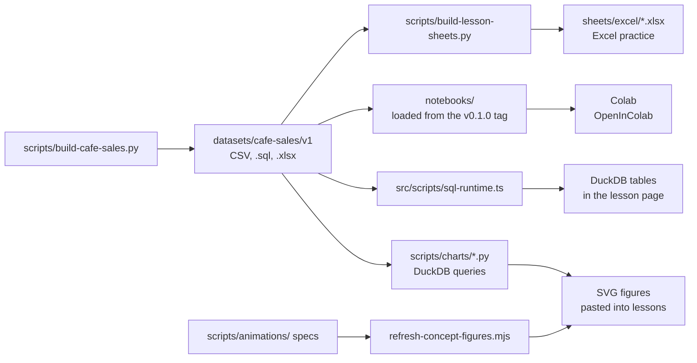
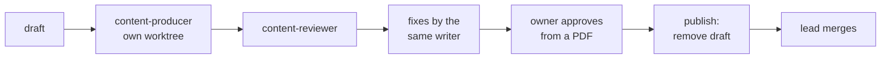
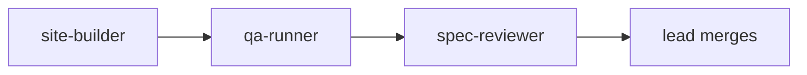

<div align="center">

<picture>
  <source media="(prefers-color-scheme: dark)" srcset="design/logo/logo-dark-bg.svg">
  
</picture>

# datafromzero

**"From A1 to AI": a free, open data roadmap for beginners who only know Microsoft Office.**

Excel and Sheets, then SQL, then Python, then an advanced core, then four data careers.

[](LICENSE-CONTENT)
[](LICENSE)
[](https://github.com/datafromzero/datafromzero.github.io/actions/workflows/ci.yml)

[Live site](https://datafromzero.github.io) ·
[Start here](https://datafromzero.github.io/start/) ·
[SPEC](SPEC.md) ·
[HANDOFF](.claude/HANDOFF.md) ·
[Changelog](CHANGELOG.md) ·
[License](#license)



</div>

## What it is

datafromzero teaches data work from zero. A learner who knows only Excel or Google Sheets follows one path through
Excel and Sheets, SQL, Python and an advanced core, then picks one of four careers. Every lesson is a plain Markdown
file in this repository, built into a static site with [Astro](https://astro.build) and
[Starlight](https://starlight.astro.build) and deployed to GitHub Pages. Version 1.0.0 was released on 2026-11-25. Found a mistake? Use the **Report a problem** button at the bottom of any
page; no account is needed.



Published lessons per stage, counted from the files (a lesson with `status: draft` is not counted and is never
deployed). Data Engineer is 20 lessons plus an 11-lesson optional deep dive. ML / AI Engineer has 8 more drafts.
A lesson code is the stage letter plus `order / 10`: `S12` is the SQL lesson with `order: 120`.

## Architecture

Content goes through schemas, then one Astro build, then the quality gates, and ships as static files. The only
JavaScript is the small, named set in the second diagram.



What the browser receives from `dist/`:



| Where | JavaScript it ships | Decision |
|---|---|---|
| `/` | GSAP; each effect is a deferred chunk loaded after first paint | D28 |
| Every page | The taskbar script, under 1 KB gzipped | D31 |
| `/start/` and the eight stage pages | `src/scripts/progress.ts`, under 2 KB; ticks stay in the browser | D64 |
| `/career-quiz/` | One scoring script, under 4 KB; stores and sends nothing | D33 |
| Lessons with `<RunSQL>`, `/sql/playground/` | A tiny module (about 1 KB); the editor and the self-hosted DuckDB-Wasm engine load in the background near a block | D42 |
| Every other lesson | Nothing of its own. Figures are CSS only: steppers and animations with a pause button | D41 |

<details>
<summary>The gates behind <code>npm run check</code></summary>

`scripts/check.mjs` runs all of these and prints a summary:

- spelling (cspell) and markdown style (markdownlint), which include this README
- the knowledge graph is current, and the lesson rules from `.claude/MISTAKES.md` (`check:lessons`)
- lesson durations (D65) and figures matching their generators (`check:durations`, `check:figures`)
- the build, which also validates every schema and every internal link
- the sitemap, no owner placeholders on deployed pages, the prerequisite graph (`src/lib/graph.ts`), the changelog
- unit tests, fixture tests (valid builds, invalid ones must fail), notebooks without outputs, and the dataset checks

Lighthouse CI (mobile, performance at least 90, accessibility at least 95) is separate: `npm run lighthouse`.

</details>

## Repository map

```text
src/
  content/docs/        the lessons and project pages, one folder per stage:
                       excel sql python core data-analyst data-engineer data-scientist ml-engineer
                       reference/glossary/ holds the glossary, one file per word
  content.config.ts    the Zod content collections (SPEC section 5)
  components/
    content/           authoring components: Exercise, Solution, OpenInColab, OpenInSheets, RunSQL, Term
    home/              the homepage sections
    lesson/            lesson header and footer
    project/           start map, career quiz, consent, stage lists, progress controls
    starlight/         overrides of Starlight parts
    taskbar/           the bottom taskbar
    cheatsheet/        the printable stage cheatsheets
  scripts/             browser scripts: taskbar, progress, quiz, SQL runner, homepage (home/)
  lib/                 build-time code: schemas, prerequisite graph, roadmap, remark and rehype rules
  styles/              tokens, homepage, print, SQL runner, step animations
  pages/               pages that are not lessons: the homepage, cheatsheets, the SQL playground
  redirects.ts         renamed URLs (never delete a published URL)
scripts/               generators and checks: datasets, workbooks, figures, durations, the knowledge graph
  animations/ charts/  figure specs and chart generators
datasets/              cafe-sales, app-events, cafe-menu-accents (versioned, built by scripts/)
sheets/excel/          practice workbooks for the Excel lessons
notebooks/             Colab notebooks: python, core, data-scientist, ml-engineer
starters/              starter repositories for the Data Engineer and ML Engineer tracks
workers/feedback/      the small service behind the feedback form
tests/                 unit tests and fixtures (valid and invalid sites, never in src/content)
research/              curriculum research and the synced research issues
design/                tokens, logo files, homepage prototype, this README's screenshot
.claude/               agents/, kb/ (knowledge graph), HANDOFF.md, MISTAKES.md, skills/
SPEC.md                the long-term contract; CLAUDE.md: the rules for working here
```

## Data flow

One synthetic dataset, `datasets/cafe-sales/v1`, sits under every stage. The generator is deterministic, so every
file can be rebuilt and compared (`--check`).



The Tables panel of the SQL runner reads column names from `cafe-sales.sql` at build time (`src/lib/cafe-schema.ts`).
`app-events` has its own generator (`build-app-events.py`), and `cafe-sales/v1/extras/` holds three derived teaching
files with their own generators. Notebooks fall back to the local `datasets/` folder when the network is off.

## How a lesson is made

Lessons are drafted from the owner's outline or text, reviewed, and published only with the owner's approval. Code changes follow a shorter chain. The roster and token rules are in `.claude/agents/README.md`.



Code changes:



A lesson PR waits for the owner. A code PR is merged by the lead when CI is green, `spec-reviewer` approved and no
owner decision is pending. CONTRACT changes, SPEC decisions, dependencies that ship JavaScript to lessons and URL
renames always go to the owner first (CLAUDE.md, "Merging").

## Pages and URLs

Every URL below is in the current build. A renamed URL needs an entry in `src/redirects.ts` (SPEC 3.3).

| URL | What it is |
|---|---|
| `/` | The homepage |
| `/start/` | The roadmap: every lesson in study order, with done ticks kept in the browser |
| `/excel/` `/sql/` `/python/` `/core/` | The four core stages: lesson lists |
| `/data-analyst/` `/data-engineer/` `/data-scientist/` `/ml-engineer/` | The four careers: lesson lists |
| `/{stage}/{slug}/` | A lesson. The slug is the file name, with no numbers |
| `/excel/cheatsheet/` `/sql/cheatsheet/` `/python/cheatsheet/` | Printable cheatsheets, no JavaScript |
| `/sql/playground/` | The SQL runner on a full page, with the cafe-sales tables ready |
| `/reference/glossary/` · `/reference/glossary/{term}/` | The glossary: plain-English words, A to Z; lessons link to it with `<Term>` (D68) |
| `/career-quiz/` · `/choose-your-track/` | Ten questions that suggest a career · how the four careers differ |
| `/about/` `/cite/` `/changelog/` `/license/` `/privacy/` `/translate/` | Project pages |
| `/feedback/sent/` `/feedback/not-sent/` | Thank-you pages of the feedback form; not indexed |

Other reference pages, career guides and dataset pages are in SPEC section 3.1 but not built yet. The old `/vi/` URLs redirect to English (D30).

## Working on it

<details>
<summary>Commands</summary>

Use the Node version in `.nvmrc` (`nvm use`), then:

```sh
npm ci                   # install the pinned dependencies
npm run dev              # local dev server
npm run build            # production build to dist/ (schemas and links checked)
npm run preview          # serve the build
npm run check            # every blocking gate
```

Single gates: `npm run spell`, `lint:md`, `check:lessons`, `check:graph`, `check:figures`, `check:kb`,
`check:notebooks`, `test:unit`, `test:fixtures`.

- `npm run kb` rebuilds the knowledge graph after changes to SPEC, CLAUDE.md, `src/`, `scripts/` or config. A pre-commit
  hook (`.githooks/pre-commit`, set up by `npm ci` or `npm run setup-hooks`) does it for you when the graph is stale. Search it
  with `node scripts/kb.mjs query <terms>` before opening big files.
- `npm run durations` shows the model behind each lesson's `duration` (D65).
- `npm run perf` checks homepage frame times; `npm run lighthouse` runs Lighthouse CI on the fixture site.
- `npm run review-report` lists lessons whose `reviewed` date is older than 18 months.

Deploys run on every push to `main` (`.github/workflows/deploy.yml`). CI (`ci.yml`) runs the checks and Lighthouse
on every PR.

</details>

## Rules that bite

<details>
<summary>The hard rules, one line each (full text in CLAUDE.md)</summary>

Read `.claude/HANDOFF.md` and `.claude/MISTAKES.md` first. `SPEC.md` is authoritative.

- No AI attribution anywhere. The owner is the sole author.
- Nothing from China (D62): no models, tools, libraries, services or brands, not even as example values.
- Never break a published URL; slugs are topic names, no numbers, with a trailing slash.
- Schemas are enforced; a missing required field fails the build.
- Lessons are plain `.md`; `.mdx` only for the components in SPEC section 6; no raw scripts in content.
- Motion: GSAP on `/` only, loaded on demand; about 3 KB of JavaScript before first paint; respect
  `prefers-reduced-motion`; every page readable without JavaScript.
- Speed: lessons ship no JavaScript beyond Starlight, the taskbar and the exceptions in the table above.
  Lighthouse mobile performance at least 90, accessibility at least 95.
- American English only for now (D30).
- Licenses: content and datasets CC BY 4.0, code MIT.
- Google Analytics 4 only after consent, with Consent Mode v2 set to denied by default.
- No accounts, no server-side progress, no comments. Progress lives in the browser only (D64).
- A change to a CONTRACT section or a SPEC decision updates `SPEC.md` and `CHANGELOG.md` in the same PR.

</details>

## License

- Content (lessons, reference, datasets): [CC BY 4.0](LICENSE-CONTENT)
- Code: [MIT](LICENSE)

Cite the site with the DOI [10.5281/zenodo.24523880](https://doi.org/10.5281/zenodo.24523880), which always points to
the latest version. The [cite page](https://datafromzero.github.io/cite/) has APA and BibTeX for each version, and
[`CITATION.cff`](CITATION.cff) is the machine-readable record.

© 2026 datafromzero
